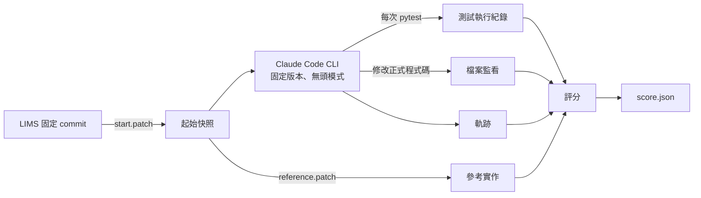

# pstack-tdd-bench

[](https://github.com/ChMno2/pstack-tdd-bench/actions/workflows/ci.yml)
[](https://github.com/ChMno2/pstack-tdd-bench/actions/workflows/image.yml)

讓 AI Agent 在版本固定的容器裡無人值守地做 TDD 任務，比較「基準 Agent」和「pstack 工作流程」寫出來的測試品質。每次執行都會留下完整軌跡，評分結果可以重跑復現。

這是軟體測試課程的期末專題（第 7 組）。名詞定義見 [GLOSSARY.md](GLOSSARY.md)。

## 運作方式

一次**執行**是「一個任務、一個條件、一次重複」。流程如下：



- Agent 以無權限帳號 `agent` 執行，讀不到參考實作、植入的 bug，也讀不到 LIMS 的 git 歷史。
- 測試紀錄和檔案監看都在 Agent 之外進行，與使用哪個 harness 無關。
- Agent 自己說「完成了」只會記錄下來，不影響任何分數。

### 實驗條件

| 條件 | 內容 | 狀態 |
|---|---|---|
| C1 基準 | 固定版本的 Claude Code，只給任務描述，提示要求以 TDD 進行 | 可用 |
| C2a pstack 單一模型 | C1 加上 pstack 官方的 Claude Code 版本，所有角色都用 `claude-sonnet-5-5` | 可用 |
| C2b pstack 預設多模型 | pstack 預設的 Grok 與 Opus 分工 | 視成本決定 |
| C3 測試設計技能 | C2a 加上我們自製的等價類、邊界值與存活 mutant 回饋技能 | 第 15 週 |

### 評分項目

| 項目 | 意思 |
|---|---|
| `tests` | 新增、刪除、修改了哪些測試。新增為零就是**無測試執行** |
| `red` | 新增的測試放回起始快照上，是否至少一個失敗 |
| `green` | 新增的測試在參考實作上連跑 3 次，分成有效、失敗、不穩定 |
| `adherence` | 在 Agent 第一次修改正式程式碼之前，新測試是否已經失敗過 |
| `coverage` | 有效測試對任務模組的行覆蓋率與分支覆蓋率 |
| `mutation` | 有效測試對任務模組的變異分數（mutmut 3.7.0） |
| `planted` | 每個植入的 bug 是否被有效測試抓到 |
| `contaminated` | Agent 是否試圖取得公開的 LIMS 原始碼 |
| `cost` | token 用量（依主 Agent 與各子 Agent 拆分）、自動回覆次數 |

欄位的詳細說明與解讀注意事項在 [docs/running.md](docs/running.md)。

## 目前狀態

- C1、C2a 與冒煙任務 `T00-smoke` 已完成。
- 容器映像、LIMS 冒煙測試（427 個後端測試全過）和不需憑證的假 Agent 全流程演練，都已在 GitHub Actions 上通過。
- 尚未完成：用真正的 Claude Code 跑冒煙任務（需要訂閱 token），以及正式任務集（第 12 週凍結）。

## 快速開始

以下是第一次跑實驗的步驟，細節見 [docs/running.md](docs/running.md)。

**1. 取得權限。** 請 repo 擁有者把你加為 collaborator。

**2. 設定憑證。** 由訂閱擁有人在自己的電腦執行：

```bash
claude setup-token
gh secret set CLAUDE_CODE_OAUTH_TOKEN -R ChMno2/pstack-tdd-bench
```

正式執行改用 API key，存成 `ANTHROPIC_API_KEY`。

**3. 觸發一批實驗。** 用指令：

```bash
gh workflow run run.yml -R ChMno2/pstack-tdd-bench \
  -f task=tasks/T00-smoke -f condition=C1 -f reps=1 -f auth=subscription
```

也可以到 GitHub 網頁的 **Actions → run → Run workflow** 填表觸發。

**4. 下載結果。**

```bash
gh run list -R ChMno2/pstack-tdd-bench --workflow run.yml --limit 5
gh run download <run-id> -R ChMno2/pstack-tdd-bench -D results/
```

每次重複是一個 artifact，裡面有 `run.json`、`score.json`、軌跡和 Agent 最後的工作區。`score.json` 的內容也會直接顯示在該次 workflow 的 Summary 頁面。

**注意：** 這個 repo 是公開的，artifact 任何人都下載得到。憑證會被自動遮蔽，上傳前也會再掃描一次。

## 新增任務

每個任務是 `tasks/<id>/` 下的一個目錄，內容包括 `task.yaml`、`start.patch`、`reference.patch` 和 `planted/*.patch`。寫法、產生 patch 的步驟和規則見 [docs/writing-tasks.md](docs/writing-tasks.md)。寫完後先在本機驗證：

```bash
bench check-task --task tasks/<id>
```

## 本機開發

需要 Python 3.12 和 [uv](https://docs.astral.sh/uv/)。測試不需要資料庫，也不需要網路。

```bash
git clone --recurse-submodules https://github.com/ChMno2/pstack-tdd-bench.git
cd pstack-tdd-bench
uv venv --python 3.12 && . .venv/bin/activate
uv pip install -e '.[dev]'
pytest -q
```

## 專案結構

```
bench/              Python 套件
  task.py           任務格式
  task_check.py     bench check-task
  snapshot.py       起始快照、參考實作、植入 bug 版本
  conditions.py     條件、提示詞、CLI 參數與環境變數
  runner.py         一次執行：啟動 CLI、自動回覆、逾時、遮蔽憑證
  trajectory.py     軌跡格式與 Claude Code 輸出轉換
  watch.py          正式程式碼修改監看
  testlog/          pytest 執行紀錄外掛
  scoring/          測試差異、紅綠燈、遵循度、覆蓋率、變異分數、彙整
  prompts/          提示詞範本
tasks/              任務（Agent 讀不到）
sut/lims/           受測系統，git submodule
vendor/pstack/      原封不動的 pstack Claude Code 版本
image/              容器映像與依賴鎖定檔
.github/workflows/  ci、image（建置與演練）、run（跑實驗）
docs/               使用說明、ADR、設計規格與實作計畫
tests/              bench 自己的測試
```

## 固定的版本

| 項目 | 版本 |
|---|---|
| 受測系統 LIMS | `227be16` |
| pstack | v0.15.36，commit `c742dd6` |
| Claude Code CLI | 2.1.322，關閉自動更新與遠端功能旗標 |
| 模型 | `claude-sonnet-5-5`，主 Agent 與所有子 Agent 相同 |
| Python | 3.12 |
| mutmut | 3.7.0 |
| 容器映像 | 見 [image/IMAGE_DIGEST](image/IMAGE_DIGEST) |

這些值都會寫進每次執行的環境指紋（`run.json` 的 `fingerprint`）。

## 文件

- [docs/running.md](docs/running.md)：跑實驗、讀結果、已知限制。
- [docs/writing-tasks.md](docs/writing-tasks.md)：寫任務。
- [GLOSSARY.md](GLOSSARY.md)：名詞定義。
- [docs/adr/](docs/adr/)：重要決定與理由。
- [設計規格](docs/superpowers/specs/2026-11-11-bench-design.md)與[實作計畫](docs/superpowers/plans/2026-11-11-bench-mvp.md)。

## 授權

本 repo 採用 MIT 授權。`vendor/pstack/` 保留原作者 Lauren Tan 的 MIT 授權聲明。受測系統 LIMS 沒有附授權條款，公開含 LIMS 程式碼的實驗結果之前，需先取得 LIMS 團隊同意。
